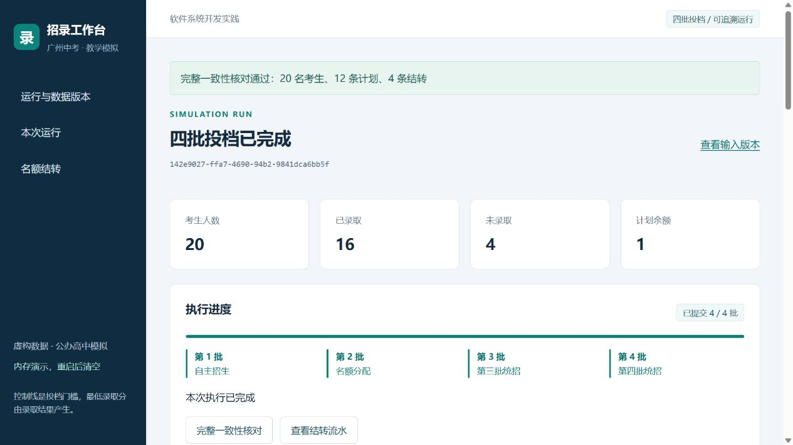
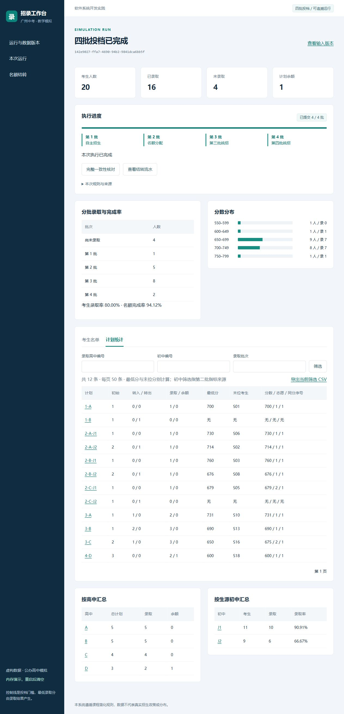
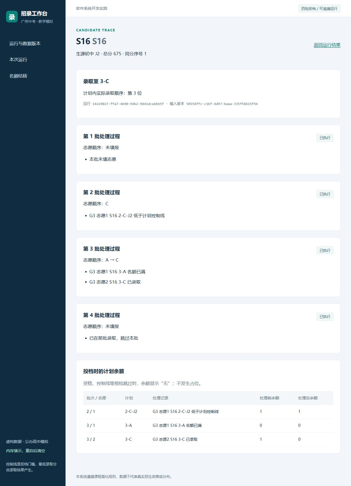

# 简化广州中考公办高中录取模拟系统

> 从输入数据到四批投档，从考生去向到名额结转，让每次模拟都有可追溯的依据。

《软件系统开发实践》课程设计。按课程简化规则实现自主招生、名额分配、梯度志愿投档、计划结转、结果查询与统计分析，提供本机 Web 工作台和 MySQL 持久化存储。所有学校、考生与成绩均为虚构数据。

**Python 3.14 · Flask 3.1 · Jinja · MySQL 8.4 · 原生 HTML / CSS / JavaScript**

| 规模验收 | 自动化测试 | 数据与运行 |
| :--- | :--- | :--- |
| **150,000 名考生**，真实 MySQL 保存与查回 | **36 项**：默认 34 项通过、2 项集成测试跳过 | 不可变输入版本、逐批检查点、历史结果可追溯 |

[界面预览](#界面预览) · [功能概览](#功能概览) · [快速开始](#快速开始) · [规则与设计](#规则与设计) · [规模与性能](#规模与性能) · [测试验证](#测试验证) · [项目结构](#项目结构) · [文档导航](#文档导航)

## 界面预览

运行工作台集中展示考生人数、录取结果、计划余额、分批进度和一致性核对入口。



<details>
<summary>展开查看：计划统计与考生处理过程</summary>

**计划统计**：查看各批录取、分数分布、逐计划最低分与末位考生，以及高中和生源初中汇总。



**考生过程**：逐批解释志愿处理结果，并记录判断前后的计划余额。



</details>

以上为实际浏览器操作的 **20 人内存演示截图**，其中的运行编号为临时演示编号。真实 MySQL 的规模保存、事务和查询验收另有原始报告，见下方证据链接。

## 功能概览

| 模块 | 已实现功能 |
| --- | --- |
| 数据管理 | 维护初中、高中、考生、四批志愿、招生计划、自主招生资格与校内排名；编辑前校验结构与引用 |
| 数据生成与导入 | 固定随机种子生成虚构数据；Web 支持 20 至 150000 人；导入、导出完整 JSON 输入 |
| 投档执行 | 按批推进或完成剩余全部批次；自主招生、初中指标隔离、梯度与志愿轮次优先、跨批排除和余额结转 |
| 规则参数 | 创建运行时设置模拟年度、全市控制线、第一梯度线和梯度间隔，各次运行独立保存参数 |
| 考生查询 | 按编号或姓名、录取高中、生源初中、批次、计划及录取状态筛选；查看各批处理原因与余额事件 |
| 统计与导出 | 分批人数、分数分布、高中与初中汇总、计划完成率、最低分与末位考生；筛选名单和五维统计 CSV 导出 |
| 版本与恢复 | 编辑生成新输入版本；运行固定版本、规则和源码摘要；逐批事务检查点支持重启后继续 |
| 一致性核对 | 从输入与检查点重新生成投影，核对全部考生、计划、录取顺序、汇总和结转；拒绝陈旧批次写入 |
| 预测试与滑档 | 原始 20 人样例，以及只调整 S11 或 S12 第三批志愿的两组独立对照 |

前端直接使用本地模板、样式和脚本，无需 Node.js 或前端构建工具。

## 快速开始

### 已配置好的本机：双击即可

**双击项目根目录的 [`00_启动系统.bat`](00_启动系统.bat)。**

启动器会定位项目目录、使用 `.venv` 中的 Python、读取本机应用密码，确认主库可访问后自动打开浏览器。再次双击会打开已运行的同一系统。

- 默认访问地址：<http://127.0.0.1:5000>。
- 运行期间保留启动窗口；停止时按 **Ctrl+C** 或关闭窗口。
- 需要本机 **MySQL84** 服务运行。现有账号、密码和数据库继续使用，无需为日常启动重新初始化或导入。
- 应用密码保存在被 Git 忽略的 `config/password.txt`；缺少该文件时，窗口才提示输入现有应用密码。

操作速查见 [`00_使用说明.md`](00_使用说明.md)。

### 新机器：先运行内存演示

已验证环境为 **Windows、CPython 3.14.3、MySQL 8.4.13**。以下命令在下载或克隆后的项目根目录，用 PowerShell 执行：

```powershell
# 创建环境并安装依赖
py -3.14 -m venv .venv
.\.venv\Scripts\python.exe -m pip install -r requirements.txt

# 不连接 MySQL，自动打开内存演示
.\.venv\Scripts\python.exe -B .\manage.py web --demo --open-browser
```

演示模式已装入 20 人原始输入，**重启后数据清空**；它适合查看界面与验证业务流程。双击 BAT 默认启动的是 MySQL 持久化模式，新机器使用它之前须完成数据库配置。

需要持久化时，按 [部署与使用](docs/部署与使用.md) 准备本机 MySQL、应用账号与独立主库 `admissionsim_app`。非密码配置参考 [`config/config.example.json`](config/config.example.json)，本机覆盖文件为 `config/config.local.json`。首次初始化使用 `manage.py init-db`，已有主库不必重复初始化。

### 第一次体验建议

1. 在首页选择原始 20 人数据版本，保留默认参数：控制线 **600**、第一梯度线 **720**、间隔 **40**，点击“创建运行”。
2. 点击“执行下一批”，观察自主招生与余额结转，再点击“完成剩余全部批次”。
3. 检查分批录取人数为 **1 / 5 / 8 / 2**，总录取 **16 人**、未录取 **4 人**、剩余 **1 个名额**。
4. 切换到“计划统计”，对比 `3-C` 的最低分 **650** 与末位考生 `S16` 的 **675 分**；点击考生查看具体过程。
5. 点击“完整一致性核对”，再尝试筛选名单、导出 CSV 或查看结转流水。
6. 回到首页，分别创建“对照 A”和“对照 B”，比较调整志愿后的结果。

## 规则与设计

### 四批投档与名额结转

默认四批志愿上限为 **1 / 3 / 6 / 6**，控制线和梯度参数随运行保存。

| 批次 | 核心规则 | 余额处理 |
| --- | --- | --- |
| 第一批：自主招生 | 校验资格及控制线，按招生学校的校内考核排名录取 | 本校剩余名额转入第三批 |
| 第二批：名额分配 | 按高中与生源初中定位子计划，其他初中的指标不能混用 | 逐来源记录转出，按高中汇总转入本校第三批 |
| 第三批：统招 | 按梯度、志愿轮次、总分与同分序号投档，使用结转后的名额 | 不向第四批转入余额 |
| 第四批：统招 | 使用独立第四批计划；前三批已录取者不再参与 | 保留最终余额 |

第二至第四批按 **梯度 → 志愿轮次 → 当前轮考生** 处理；当前轮考生按总分降序、同分序号升序。不能用“按总分依次试完每个人所有志愿”替代，否则会改变同梯度内的志愿优先关系。

### 输入版本、事务与恢复


- **输入不覆盖**：每次编辑保存独立数据版本；已有运行仍引用原版本，保留规则与来源摘要。
- **批次原子提交**：运行汇总、考生结果、计划统计、增量结转和检查点在同一事务中保存，失败时整批回滚。
- **按检查点继续**：从最后一个已提交批次恢复，尚未提交的批次重新计算；通过预期批次条件更新拒绝陈旧写入，避免重复结转。
- **查询投影与核对**：按考生及计划组织高频查询记录，同时保留输入与完整检查点；独立重建投影核对冗余一致性。

### 最低分与末位考生分别计算

**最低录取分**是计划内已录取考生总分的最小值；**末位考生**是按实际投档顺序最后录取的人。志愿轮次优先可能让低分第一志愿先录、高分第二志愿后录，二者不能混为一个字段。

原始样例的 `3-C` 最低分为 **650**，末位为 **S16 / 675 分 / 第 2 志愿 / 同分序号 1**。无人录取时相关字段为空，页面显示“无”。

## 规模与性能

### 已完成的真实规模验收

系统包含 20 人边界样例与两组滑档对照，另保留 **1 万、5 万、15 万人**的数据生成及实验记录。15 万人数据采用固定种子 `20261118`，包含 **500 所初中、150 所高中、48250 条计划、120000 个初始名额**。

| 15 万人正式结果 | 数值 |
| --- | ---: |
| 第一批录取 | 6,184 |
| 第二批录取 | 39,722 |
| 第三批录取 | 50,094 |
| 第四批录取 | 19,291 |
| 总录取 | **115,291** |
| 剩余名额 | **4,709** |
| 结转流水 | **8,378 条** |

主系统正式运行编号为 `72d861eb-9eb5-4faf-b117-6712d2764838`，位于 `admissionsim_app`；历史对照运行 `0113c1d3-e855-42db-a16f-2578e5f3ab78` 位于独立规模库。输入、四批结果、检查点与全部冗余已通过真实保存及查回核对。详见 [主系统完整验收](experiments/app_mysql_acceptance_v1/acceptance.json)。

这些是开发机器上已完成的实验；克隆仓库不会同时复制本机数据库。大输入和完整结果 JSON 由 Git 忽略，复现方式见 [部署与使用](docs/部署与使用.md)。

### 查询优化对照

同一输入与规则下，比较历史整次快照 / 日志查询和新的结构化结果查询。每种实现预跑一轮、正式三轮，合计 **56 次查询结果核对**。

| 查询范围 | 旧实现中位数 | 优化后中位数 |
| --- | ---: | ---: |
| 全部 48250 条计划及全运行汇总 | 3.660617 s | **1.851812 s** |
| 第一批录取考生 `S000002` | 2.259670 s | **0.001461 s** |
| 第三批录取考生 `S099797` | 2.564592 s | **0.000937 s** |
| 达线未录取考生 `S073470` | 2.547426 s | **0.000997 s** |

六类考生点查的最终中位数约为 **0.9–1.5 ms**。计时包含 SQL、传输、解析和结果构建，**不含建连、预检与结果核对；未清 MySQL 和操作系统缓存**，不能直接解释为完整网页响应时间或其他机器上的收益。

全计划查询在前两轮曾出现退化，相关报告、执行计划与修正记录全部保留。更细的查询投影增加了写入和存储成本，本项目没有将不同口径的执行、保存耗时直接相除。

完整方法与全部六类数据见 [真实性能对照](docs/性能实测.md)，原始样本见 [最终查询报告](experiments/app_mysql_query_v3/query_comparison.json)。

## 测试验证

在项目根目录运行现有测试：

```powershell
.\.venv\Scripts\python.exe -B -m unittest discover -v
```

当前默认发现 **36 项测试：34 项通过、2 项真实 MySQL 集成测试跳过**。集成测试需显式配置凭据及新输出目录后运行，默认跳过不能记为本次数据库测试通过。

| 测试文件 | 验证内容 |
| --- | --- |
| `tests/test_admissions.py` | 原始样例、控制线与梯度边界、初中指标隔离、同分顺序、最低分与滑档对照 |
| `tests/test_input_validation.py` | 重复考生、重复志愿、重复同分序号、负分及无对应计划等非法输入 |
| `tests/test_system.py` | 参数独立性、不可变版本、分批恢复、事务合同、陈旧请求、冗余偏差、页面与导出 |
| `tests/test_launcher.py` | 已运行系统识别、存储模式匹配、浏览器就绪打开和健康接口 |
| `tests/test_mysql.py` | 显式启用的真实回滚、持久恢复、约束、页面及筛选 CSV 集成测试 |

真实数据库证据另见 [事务故障与恢复](experiments/app_mysql_fault_v1/mysql_fault_recovery.json)、[MySQL 页面与导出](experiments/app_mysql_web_v3/web_mysql_verification.json) 和 [目录整理后启动验收](experiments/layout_20261122_v1/verification.json)。这些是对应版本的既有记录，本次 README 更新不重跑规模实验，也不改写历史摘要。

## 项目结构

```text
软件系统开发实践课程设计/
├─ 00_启动系统.bat          日常双击入口：MySQL 模式并自动打开网页
├─ 00_使用说明.md           日常操作速查
├─ README.md                GitHub 项目导航
├─ manage.py                初始化、Web、导入、运行、恢复、核对与实验入口
├─ requirements.txt         固定运行依赖
├─ admissions_app/          主系统源码
│  ├─ core/                 四批投档算法与统一流程
│  ├─ domain.py             规则、校验、分批状态与结果投影
│  ├─ repository.py         MySQL 事务存储及内存演示存储
│  ├─ service.py            公共执行服务、后台进度与来源摘要
│  ├─ web.py                Flask 页面、表单、查询和导出
│  ├─ launcher.py           本机启动检查与浏览器打开
│  ├─ datasets.py           固定种子的规模数据生成器
│  ├─ experiments.py        本地核对及真实 MySQL 验收与查询对照
│  ├─ templates/            Jinja 页面
│  └─ static/               本地 CSS 与 JavaScript
├─ config/                  连接配置示例及本机私有配置
├─ database/
│  ├─ schema_app.sql        主库表结构与授权
│  └─ legacy/               历史样例与规模实验库 SQL
├─ docs/                    设计、部署、字段、性能、测试和答辩材料
│  ├─ assets/               设计图与真实界面截图
│  └─ history/              整理前 README 归档
├─ experiments/             历次报告、源码快照及本机实验数据
├─ tests/                   自动化测试、对照案例与 fixtures
└─ tools/                   材料构建、legacy 历史工具与 diagnostics 诊断
```

本机的 `.venv`、`.idea`、教师原件与交接材料按原分类保留，不上传 Git。更详细的迁移对照和旧报告路径解释见 [目录结构与版本说明](docs/目录结构与版本说明.md)。

## 文档导航

| 想了解什么 | 对应材料 |
| --- | --- |
| 如何打开、关闭系统 | [使用速查](00_使用说明.md) |
| 环境准备、主库配置、维护命令与复现 | [部署与使用](docs/部署与使用.md) |
| 需求、架构、算法、事务与取舍 | [设计报告 Markdown](docs/设计报告.md) · [设计报告 Word](docs/设计报告.docx) |
| 表结构、字段、索引与空值含义 | [数据库字段说明](docs/数据库字段说明.md) · [主库 SQL](database/schema_app.sql) |
| 系统架构、ER 与执行流程 | [图表说明](docs/图表.md) |
| 边界案例、测试范围与证据分类 | [系统测试与证据](docs/系统测试与证据.md) · [小数据人工预期](tests/fixtures/小数据集预测试与验收.txt) |
| 优化结果、退化记录与测量方法 | [性能实测](docs/性能实测.md) |
| 演示顺序与常见答辩问题 | [演示与答辩](docs/演示与答辩.md) |
| 提交材料与版本边界 | [交付清单](docs/交付清单.md) · [目录结构与版本说明](docs/目录结构与版本说明.md) |

设计报告保留整理前 `1424f2d` 验收版本，结合目录补充说明阅读旧路径。历史实验按对应 Git 版本或当轮 `source_snapshot.zip` 复现，保留原始 SHA，不用当前源码摘要覆盖旧记录。

## 适用范围与限制

- 本项目用于课程教学模拟，按任务书简化户籍、区域、政策加分、参考科目等条件，不替代真实年度招生政策。
- 不模拟退档、放弃录取、报到注册和正式补录。
- 系统面向本机课程使用，默认监听 `127.0.0.1`，没有实现用户登录、角色权限或生产部署方案。
- 进度以已提交批次和当前阶段展示；恢复时重算尚未提交的一批，不提供逐考生中断续算。
- 输入版本采用完整聚合快照，结果保留细粒度过程；大规模下需要相应的时间与存储空间。性能结论仅适用于报告中的数据、版本与测量条件。

开发过程中使用了 AI 辅助完成部分源码、测试、实验执行与文档整理。已执行的验证以仓库测试和原始报告为依据，个人信息、课程提交格式及答辩内容由本人核实。
