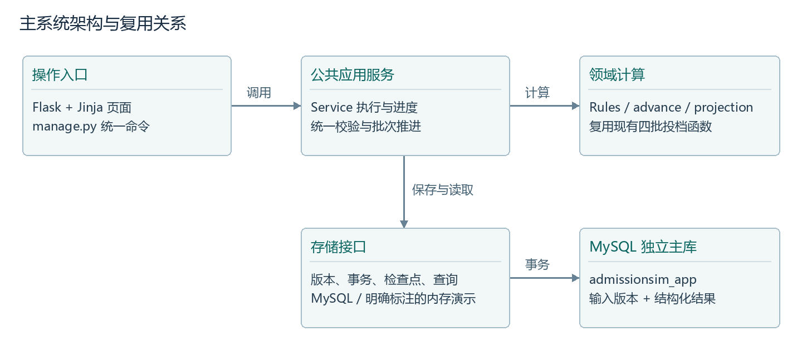
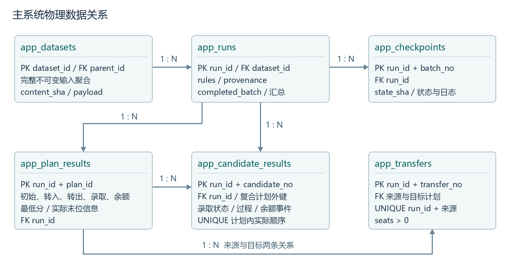
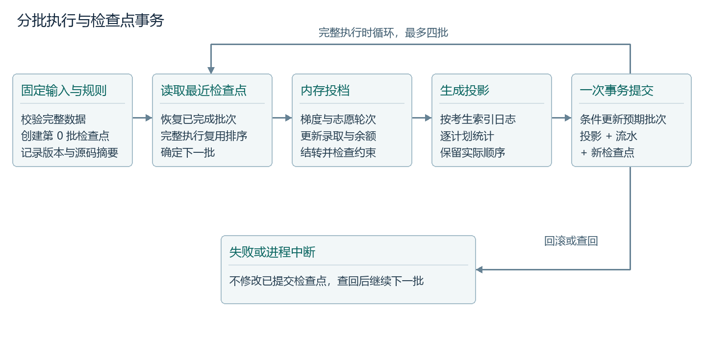
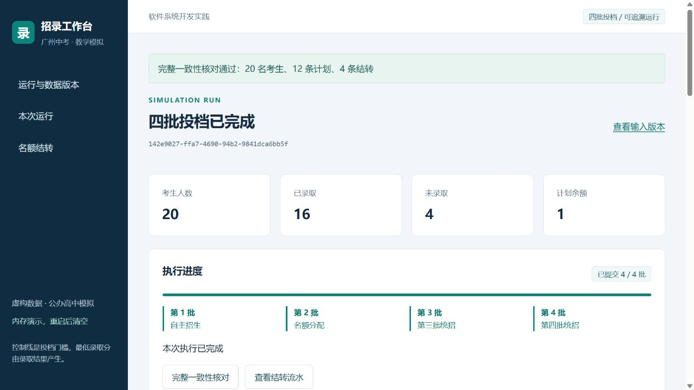

# 简化广州中考公办高中录取模拟系统设计报告

本项目按《软件系统开发实践》任务书和教师讨论提示实现公办高中四批投档。系统采用 Python、Flask、Jinja 和 MySQL，使用虚构数据，目标是在保持梯度、志愿、指标隔离和结转规则正确的前提下，提供可操作界面和可追溯的运行依据。

截至 2026 年 11 月 22 日，主系统源码和页面已形成，自动化测试、新实现 15 万人本地一致性核对、新主库真实持久化及查询优化对照均已通过。新运行编号为 72d861eb-9eb5-4faf-b117-6712d2764838，正式结果与历史完整结果一致。历史报告和本轮真实验收报告分开保存，未将内存或模拟连接测试计为数据库实测。

## 需求与简化范围

全部考生视为具有公办高中报考资格，不区分户籍、跨区、应往届，不考虑加分、政策优先及参考科目等级。第一批只模拟自主招生资格与考核排名；第二批直接输入高中向初中的名额分配。第三批高中可以设置前两批计划，第四批高中只设置第四批计划。不模拟退档、放弃、报到和正式补录。

使用者可以生成或导入数据，维护学校、考生、志愿、计划和资格，建立独立运行，按批或完整执行，查看考生去向、处理原因和当时余额，筛选多维名单、查看统计并导出 CSV。每次编辑生成新的输入版本；已保存运行继续引用原版本。

默认教学参数为全市控制线 600、第一梯度线 720、梯度间隔 40，四批志愿上限为 1、3、6、6。年度、控制线、第一梯度线和间隔由创建运行时输入。生成器继续使用既定虚构分数分布，不将现实年度参数强加给已有实验数据。

## 总体架构

系统分成页面、应用服务、领域计算和存储四部分。统一入口 manage.py 为本机初始化、导入、运行、核对、Web 和基准提供命令；页面与命令行共同调用 Service，避免维护两套投档流程。

admissions_app/domain.py 管理规则、数据校验、分批状态、投影和一致性约束。它调用原有 admission.py、second_batch.py、third_batch.py 中的投档函数，保留 run_admissions.py 的兼容入口。repository.py 集中 MySQL 连接、事务和读写，web.py 负责表单、页面和下载。experiments.py 仅承载统一命令需要的验收与基准，不成为另一套业务实现。

历史实验和三个 probe 工具保留在原位置，以保证旧报告中的路径有据可查。2026 年 11 月 18 日的实验源码以 Git 提交 30ebf707c2a7180d3ede588812458da8e4d11ff5 为准。后续源码哈希变化是版本变化，不能修改旧报告中的 SHA 使其适配新版本。

## 数据模型与版本

逻辑输入包含初中、高中、考生、计划、自主资格和志愿六类实体。初中与考生是一对多，高中与计划是一对多，考生与高中通过资格及有序志愿关联。名额分配计划同时关联高中和生源初中。年度和生成配置由数据版本及运行规则保存。

独立实验库继续保存原六张规范化输入表及既有结果。主系统采用不可变输入聚合版本：六类实体完整保存在 app_datasets 的压缩 JSON 中，父版本记录修改来源；每次编辑校验整个新聚合，并插入新行。这样运行只需引用一个版本编号，就能得到同一时刻的完整输入，避免更新多张当前输入表导致历史查询变化。代价是编辑少量数据也会保存一个完整版本，后续可用实体级版本或差量存储减少空间；本课程版本不引入该额外复杂度。

| 主系统表 | 主键 | 职责 |
| --- | --- | --- |
| app_datasets | dataset_id | 不可变输入、父版本、内容摘要、名称及人数 |
| app_runs | run_id | 输入版本、规则、源码来源、已完成批次和运行汇总 |
| app_checkpoints | run_id 与 batch_no | 每批完整状态、压缩日志及内容摘要 |
| app_candidate_results | run_id 与 candidate_no | 历史考生输入、四批过程、录取状态及事件余额 |
| app_plan_results | run_id 与 plan_id | 逐计划余额、结转、最低分与末位考生信息 |
| app_transfers | run_id 与 transfer_no | 有序保存每条名额来源和目标 |

具体字段、外键、空值语义及索引见《数据库字段说明》和 schema_app.sql。数据库 app_candidate_results 用一个 nullable 的 admitted_batch 表达是否已录取，避免“是否录取”和“录取批次”两个字段矛盾；学校、计划和志愿序号仅在已录取时有值。主键约束一名考生每次运行最多一条状态，唯一键约束同计划的实际录取顺序。

## 核心投档流程

运行前检查考生编号、成绩、同分序号、志愿上限与重复志愿，检查学校类型、计划格式、控制线、资格排名、初中指标及本校结转目标。数据编辑时检查结构和引用，创建运行时再根据该次控制线检查计划门槛。

第一批先按填报学校分组，只对具备该校资格并达到控制线的考生按校内考核排名录取。该分组复用原算法的资格和排名逻辑，减少逐校重复扫描全部考生。第一批结束将本校剩余名额转到第三批，记录细来源并清空来源余额。

第二至第四批严格按“批次、梯度、志愿轮次”扫描，同梯度同志愿轮次竞争同一计划时按总分降序、同分序号升序。主系统完整执行时只排序一次，后续批次复用这份顺序。第二批按高中与考生生源初中定位子计划，其他初中余额不能使用。第二批结束先逐来源记录转出，再按高中汇总转入第三批。第四批独立执行，不接收前两批余额。

advance 接受旧检查点并生成新状态，不原地修改已提交状态。每批完成后检查“初始加转入减转出等于已录取加余额”，检查不重复录取，再构建查询用投影。各计划的实际录取列表保持算法生成的顺序，不能查询时重新按分数排序后冒充投档顺序。

## 冗余设计与一致性维护

旧考生查询每次读取整次快照和全部日志，再在 Python 中寻找一人并构建过程。历史六类考生查询的总耗时中位数约为 1.68 至 1.82 秒，读取解析占主要部分。这说明数据访问粒度值得调整，不能据此认定服务器 SQL 或某个索引是瓶颈。

主系统在批次边界构建两类有明确用途的冗余。第一类是每名考生的输入、录取批次、高中、计划、志愿、实际顺序和处理事件；第二类是逐计划初始数、转入、转出、录取数、余额、最低分、末位编号及其分数、志愿和同分序号。原始快照及完整日志仍由版本和检查点保存。投影在一次日志遍历中按考生建立索引，不为每名考生重复扫描全量日志。

一个批次的事务先通过“run_id 与预期 completed_batch”条件更新运行行，再分批发送计划和考生投影、增量结转及新检查点，最后提交一次。500 行一批只是网络发送大小，不是 500 行提交一次。事务失败时整批回滚；已提交的上一批检查点可继续使用。并发请求即使同时计算，也只有一个条件更新成功，另一个停止，不会再次结转。

完整一致性核对从输入和检查点重新生成全部投影，与数据库逐条比较；同时检查运行汇总、全部考生状态、计划、录取顺序及结转。CSV 导出使用一份只读一致性快照，避免导出过程中混合两个已提交批次。提交响应丢失时，先查回该运行的 completed_batch 和检查点，不直接创建另一个运行或删除记录。

本实现选择批次边界集中维护数据库状态。批内的每次判断实时维护内存集合和余额，不逐考生产生数据库往返。页面展示已提交批次与当前“计算中或事务保存中”阶段，不伪装成逐考生实时百分比。进程重启后可从最后一个已提交批次恢复；尚未提交的整个批次需要重新计算。

## 查询统计与界面

考生查询通过 run_id 与 candidate_no 主键定位一条历史输入及过程记录；筛选支持考生编号或姓名、录取高中、生源初中、批次、计划和录取状态。学校统计累加各批初始名额一次，内部结转不重复计入总计划。初中统计按考生生源汇总，而计划表中的初中筛选专指第二批指标来源。

最低分是某计划全部已录取考生分数的最小值；末位是实际录取列表最后一人。20 人样例中，3-C 最低分为 650，末位 S16 为 675 分、第二志愿、同分序号 1。无人录取时相关字段为 NULL，页面显示“无”，不以 0 分代替。

页面包括数据版本、原始及两个滑档对照样例、规则表单、按批或完整执行、计划与考生列表、处理原因、余额事件、结转、分数分布和多维汇总。考生表单直接维护成绩和四批志愿，学校、计划、资格可用带格式说明的 JSON 记录编辑器维护。名单 CSV 支持筛选并处理 Excel 公式前缀；全运行统计 CSV 包含总体、批次、分数、初中和高中五个维度。CSV 均带运行编号及已完成批次，JSON 导出保留完整输入。

图中为真实浏览器操作的内存演示，展示 20 人样例录取 16 人、4 人未录取和余额 1。它证明界面及操作链路，不是新主库的 MySQL 成功截图。

## 测试与规模证据

小数据材料先于完整算法提交，固定 20 人输入及人工预期；覆盖梯度、同志愿分数与同分、控制线边界、资格、初中指标隔离、结转、空计划、重复录取和高分滑档。原始四批录取人数为 1、5、8、2，未录取 S12、S14、S19、S20。

新的 31 项自动化测试覆盖参数独立性、分批恢复、陈旧请求、保存前故障、不可变版本、冗余偏差检测、完整页面、表单校验和筛选导出。模拟连接的事务回滚测试只检验程序合同。另外，真实 MySQL 故障验收在写完本批投影和检查点后、提交前注入异常，新连接确认全部写入回滚，再从真实持久检查点继续完成投档；陈旧请求和错误余额分别被程序和数据库约束拒绝。

历史 MySQL 15 万人正式运行编号为 0113c1d3-e855-42db-a16f-2578e5f3ab78，四批分别录取 6184、39722、50094、19291 人，总录取 115291 人，余额 4709，结转 8378 条，处理日志 514014 条。历史保存经过一次事务提交，并由新连接完整查回。对应源代码及报告均保留。

2026 年 11 月 22 日的新实现本地核对得到同一完整结果 SHA256：6e670b8e715fd6110df9457a8e385d80905f2bde09a8299450778f775bc44212。此次核对还检查了全部 48250 条计划的原有统计字段及固定六类考生过程，未连接 MySQL。单次本地新实现时间不能与旧基准中位数直接相除宣称优化收益。

新主库真实验收由 manage.py accept 集中完成样例、同一 15 万人输入、分批落库、完整查回以及查询优化前后对照。最终补测在 app_mysql_query_v3 中记录。每类查询预跑一次、正式三次，保存原始样本、摘要及 min、median、max，合计 56 次查询结果核对。全运行计划统计比较完整 48250 条计划及总体汇总，不以单计划点查替代。未清数据库和操作系统缓存，连接与预检不计时，两种实现逐轮交替先后顺序。

| 最终查询范围 | 旧实现中位数 秒 | 最终实现中位数 秒 |
| --- | --- | --- |
| 全部计划及全运行汇总 | 3.660617 | 1.851812 |
| S000002 第一批录取 | 2.259670 | 0.001461 |
| S050460 第二批录取 | 2.501097 | 0.001401 |
| S099797 第三批录取 | 2.564592 | 0.000937 |
| S149993 第四批录取 | 2.535562 | 0.000877 |
| S073470 达线未录取 | 2.547426 | 0.000997 |
| S074889 低于控制线未录取 | 2.537374 | 0.000957 |

第一次结构化查询的全计划统计曾由约 4.03 秒退化至约 10.97 秒，不能因为考生点查变快就认定所有查询都更快。实际分段查询和 EXPLAIN 显示，未录名单读取为排序选择了宽主键；补充 run_id、admitted_batch、candidate_no 覆盖索引后，优化器仍会错误选择主键。因此最终仅对这条已验证 SQL 指定覆盖索引，重新按完整口径测量。两轮退化报告、执行计划、分段诊断和最终原始样本全部保留。

以上为本机本次客户端测量，不代表其他硬件、冷缓存或全部界面查询的收益。新系统四批执行与投影保存约 279.17 秒，包含四批计算、日志索引和四次事务，不能与旧系统仅最终保存结果的约 29.94 秒直接比较。查询优化以更细的历史查询记录及更多写入、存储为代价。

之后的真实界面联通检查修正了分数分布 SQL 的严格分组表达式，并发现初中汇总通过旧索引反复回表。补充界面专用的初中、分数、录取状态覆盖索引后，同一输入的全部分布及初中汇总结果保持一致；单次诊断中的初中汇总由约 30.38 秒降到约 0.59 秒。这是界面 SQL 诊断，另有原始记录，不当作三轮性能中位数。最终界面、考生查询、筛选 CSV 与全运行统计 CSV 已通过真实 MySQL 联通核对。

## 部署与已知限制

统一环境为 Windows、PowerShell、CPython 3.14.3、Flask 3.1.3、mysql-connector-python 26.10.0、MySQL 8.4.13。系统默认仅监听 127.0.0.1；主系统只允许写 admissionsim_app。root 只用于初始化与授权，日常由 admission_app 读写。默认命令通过 getpass 输入密码，不把密码写入仓库。内存演示通过 --demo 明确启用并标注重启丢失。

本系统面向本机课程演示，未实现互联网多用户登录、分布式任务队列或跨进程任务排程。后台任务状态在进程内，持久恢复依据在数据库。输入版本为完整聚合保存，编辑规模数据会消耗额外空间；每批投影也会增加数据库写入和存储成本，查询收益应结合真实测量评估。运行时规则变更必须新建运行。

首次历史保存断线根因未确认；旧 redo 等待和旧 binlog 故障分别保留为背景，不能自动认定为同一原因。新实验如有故障也独立记录，不能抹去失败报告或关闭 binlog 后冒充相同条件。

## 个人工作与总结

项目按单人课程设计组织，使用 Git 保存阶段成果，不虚构多人协作记录。AI 辅助用于规则讨论、部分源码、测试与文档生成、文件核对及在明确授权后的本机实验执行；学生仍须理解代码、核对教师要求并承担提交责任。个人姓名、学号、班级及教师规定格式由本人在提交前核实填写，不推测生成。

设计的关键是把正确的批次和志愿顺序落实到可追溯状态，再用明确的事务边界维护冗余。后续评价应分别检查业务一致性、故障恢复与真实查询测量，不能用页面数量、源文件数量或未经测量的收益代替系统完成度。
